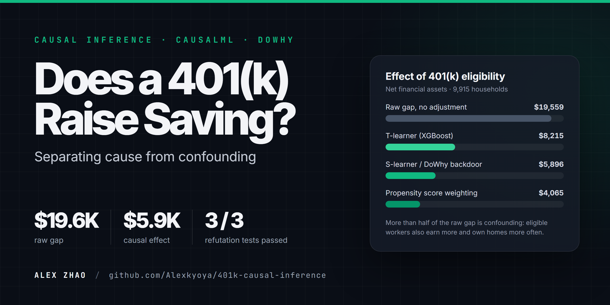

# Does a 401(k) Make People Save More?

A causal inference case study on 9,915 U.S. households that separates the true effect of 401(k) eligibility on savings from confounding.

Case study page: [alexkyoya.github.io/401k-causal-inference](https://alexkyoya.github.io/401k-causal-inference/)

## The problem
Households eligible for a 401(k) hold $19,559 more in net financial assets. But they also earn about $15,400 more per year, own homes more often and more often have a pension. How much of the gap does eligibility actually cause?

## What I built
1. A causal setup: treatment is eligibility (`e401`), outcome is net financial assets (`net_tfa`), with nine household controls.
2. Average effect estimates with CausalML (S-learner and XGBoost T-learner) and DoWhy (backdoor regression and propensity score weighting).
3. Individual effects grouped by income quintile.
4. An instrumental variable estimate of the value of actually participating (`p401`), using eligibility as the instrument.

## Results
- Raw gap: $19,559. Causal effect of eligibility: about $4,100 to $8,200, depending on the method. More than half of the gap is confounding.
- Top income quintile: gains about $20,100. Income explains 48% of the variation in the effect.
- Value of participating: about $8,500 (IV). A plain regression overstates it at $11,601, because motivated savers choose to join.

## How I validated it
1. Compared four estimators: S-learner $5,896 (95% CI $2,909 to $8,883), T-learner $8,215, backdoor regression $5,896, propensity weighting $4,065.
2. Three DoWhy refutation tests, all passed: random common cause ($5,896 → $5,896), placebo treatment (→ $68), random 80% subsets (→ $5,953).

## Tech stack
Python · pandas · NumPy · CausalML · DoWhy · XGBoost · Matplotlib

## Repo structure
- `Assignment2_401k.ipynb`: full analysis with explanations
- `401k.csv`: dataset (9,915 households, 14 variables)
- `index.html`, `script.js`, `styles.css`: the case study page
- `causal_model.png`: the causal graph

## How to run
1. Use Python 3.11 (CausalML does not build on newer versions): `conda create -n causal python=3.11`, then `conda activate causal`.
2. `pip install causalml==0.17.0 dowhy==0.14 pandas==2.3.3 networkx==3.4.2 xgboost matplotlib numpy jupyter`. The pins matter: networkx 3.5+ and pandas 3 break DoWhy.
3. `jupyter notebook Assignment2_401k.ipynb` and run all cells.

## Key takeaways
1. A raw comparison would overstate the effect by more than double.
2. The benefit goes mostly to higher earners.
3. Limits: observational 1991 data, causal only if the nine controls capture all common causes; skewed wealth; the IV estimate is local to households who join because they are eligible.

Data: 1991 Survey of Income and Program Participation, as used in Chernozhukov et al. (2018), *Double/debiased machine learning*. Individual course assignment, McGill MMA.

---
Author: Alex Zhao · McGill MMA · [LinkedIn](https://linkedin.com/in/alex-zhao-7b45a8222) · [Portfolio](https://alexkyoya.github.io)
